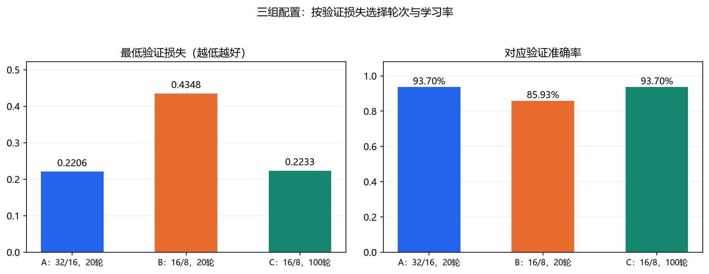
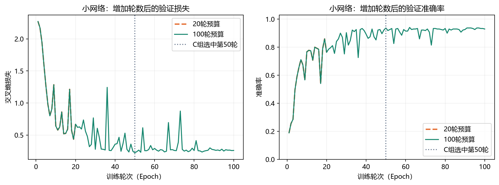
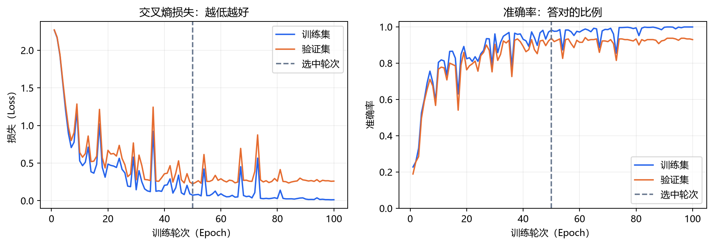
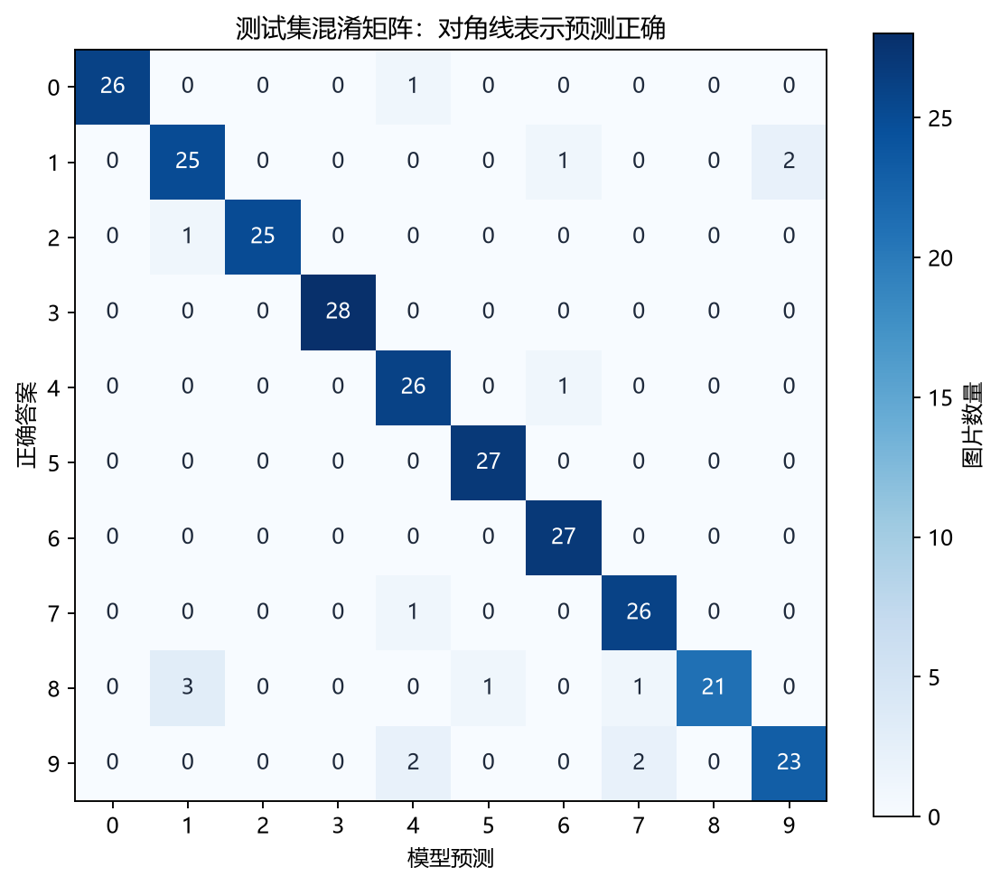
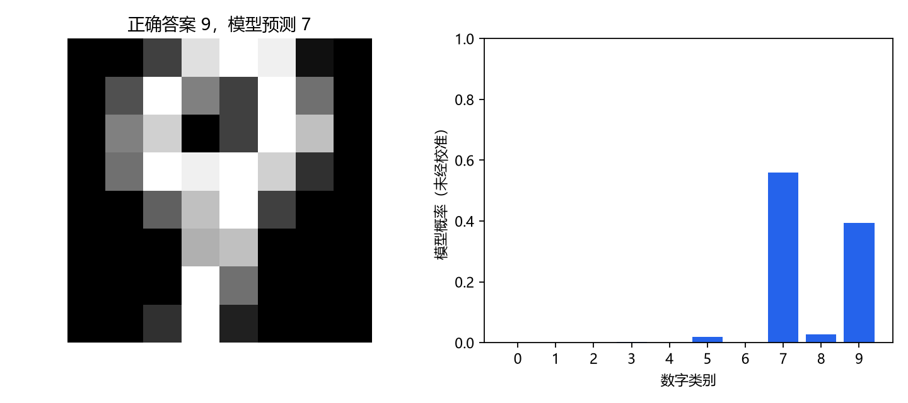

# 基于多层感知机的手写数字十分类实验报告

姓名：从国晗

## 1. 实验目标

设计并训练一个多分类神经网络。输入一张8×8手写数字灰度图片，输出数字0～9中的一个类别。实验重点是理解全连接网络、交叉熵、反向传播与参数更新，并通过对照实验检查网络宽度和训练轮数的影响。

## 2. 数据与预处理

使用scikit-learn内置的Digits公开数据集，共1797张图片，每张图片有64个像素特征，标签是0～9的整数。数据由公开数据集提供，并非自行采集。

将图片按行展开为64个数，使用已知像素范围0～16，将输入固定除以16，缩放至0～1；类别标签保持整数。该缩放无需利用验证或测试数据估计统计量。

使用随机种子42进行分层随机划分：训练1257张、验证270张、测试270张，比例约为70%、15%、15%。三组实验的原始数据、标签和三个集合的索引已经逐项核对一致；集合之间不交叉。

训练集参与梯度与参数更新，验证集用于比较设置及保存最佳轮次，测试集用于记录选定模型的表现。

## 3. 模型与训练方法

采用两个隐藏层的多层感知机（MLP）。基线结构为64 → 32 → 16 → 10，小网络为64 → 16 → 8 → 10。隐藏层使用ReLU，输出层返回十个类别的原始分数。

全连接层的计算为`y = Wx + b`。一层从n个输入到m个输出，参数量为`n×m+m`。两种结构的参数量分别为2778和1266。输入64来自图片像素数量，输出10来自类别数量，中间的隐藏层大小是人为选择的设计。

损失采用`CrossEntropyLoss`，代码直接传入原始分数，不提前加Softmax。对于一个正确类别为k的样本，损失可理解为`−ln(p_k)`，正确类别的模型概率越高，损失越低。推理时选择分数最高的类别。

优化器为普通SGD，batch size为32，学习率候选为0.1和0.01，不使用动量、权重衰减或学习率调度。计算设备为CPU。

核心训练循环如下：

```python
optimizer.zero_grad()                         # 清空上一批的梯度
scores = model(batch_features)                # 前向传播
loss = criterion(scores, batch_labels)        # 计算交叉熵
loss.backward()                              # 计算参数梯度
optimizer.step()                             # 更新参数
```

`backward()`计算梯度，`step()`才实际修改权重。普通SGD的更新为`w_new = w_old − lr × gradient`。1257个训练样本按32个一批，每轮40次更新；20轮对应800次更新，100轮对应4000次更新，均指每个学习率候选。

## 4. 对照实验设计与事前猜测

共设计三组配置，每组都比较相同的两个学习率，因此共有六次候选训练。各候选均从随机初始化重新开始训练，每组按最低验证损失选取候选及其保存轮次。

- A组：隐藏层32、16，每个学习率训练20轮，作为基线。
- B组：隐藏层16、8，每个学习率训练20轮。相对A只主动改变网络宽度。运行前猜测原话：“效果会变好，因为隐藏层缩小了。”
- C组：保留隐藏层16、8，将每个学习率的训练预算改为100轮。相对B只改变轮数上限。运行前猜测原话：“我认为会变好，因为训练多了应该有经验了。”

## 5. 实验结果

表中验证与测试指标对应各组按验证损失选中的权重，三组均选中学习率0.1。

| 组别 | 隐藏层 | 参数量 | 轮数上限 | 选中轮次 | 验证损失 | 验证准确率 | 测试正确数/准确率 |
| --- | --- | --- | --- | --- | --- | --- | --- |
| A | 32、16 | 2778 | 20 | 16 | 0.2206 | 93.70% | 254/270，94.07% |
| B | 16、8 | 1266 | 20 | 19 | 0.4348 | 85.93% | 237/270，87.78% |
| C | 16、8 | 1266 | 100 | 50 | 0.2233 | 93.70% | 253/270，93.70% |



两种学习率的候选结果如下；没有对未选中的候选额外做测试成绩比较。

| 组别 | 学习率 | 最佳轮次 | 最低验证损失 | 对应验证准确率 |
| --- | --- | --- | --- | --- |
| A | 0.1 | 16 | 0.2206 | 93.70% |
| A | 0.01 | 20 | 2.1033 | 35.19% |
| B | 0.1 | 19 | 0.4348 | 85.93% |
| B | 0.01 | 20 | 2.1645 | 24.07% |
| C | 0.1 | 50 | 0.2233 | 93.70% |
| C | 0.01 | 100 | 0.5536 | 78.89% |

### 5.1 缩小网络的影响：A与B

在相同20轮预算下，缩小隐藏层后，验证准确率从93.70%降至85.93%，验证损失从0.2206升至0.4348。选中权重的训练准确率也从96.58%降至89.18%。本次结果没有支持“缩小网络就会变好”的猜测。

参数减少有时有助于限制过拟合，但模型还需具备适当的表达能力，并完成充分训练。当前结果不能将差距完全归因于容量，也不能推出小网络在所有训练设置下都更差。

### 5.2 增加训练轮数的影响：B与C

保持小网络结构后，将轮数上限从20增加到100，最低验证损失从0.4348降至0.2233，对应验证准确率从85.93%升至93.70%；测试正确数从237提高到253，增加16张。

这支持了“在当前设置下增加训练轮数可以改善小网络表现”的猜测。“训练更多有经验”可以具体解释为：模型对同一批1257张训练图片进行了更多次损失、梯度计算和参数更新。数据数量和图片多样性没有因此增加。

两次小网络实验的前20轮逐项记录完全相同。C组从相同初始化重新训练100轮，其前20轮与B组一致，随后继续更新参数至100轮；它没有从B组保存的第19轮权重接着训练。



### 5.3 为什么C组选择第50轮

C组完整训练100轮，但保存并恢复验证损失最低的第50轮。第50轮训练损失为0.0729，验证损失为0.2233，验证准确率为93.70%；第100轮训练损失降至0.0124，验证损失却为0.2598，验证准确率为92.96%。

继续训练后训练集表现改善，验证表现没有同步改善，提示后期泛化可能受限。曲线存在波动，训练轮数增加不能保证每一轮表现都提高。恢复最佳权重与提前停止训练是不同操作，本实现仍执行了全部100轮。



### 5.4 三组配置的选择

按照实验前约定的最低验证损失规则，本次交付选择A组：验证损失0.2206，略低于C组的0.2233。A、C验证准确率均为93.70%，测试集分别答对254和253张，只差1张，不能证明A具有稳定或显著的泛化优势。

C组参数更少，但采用更长训练预算。网络选择需要结合验证表现和资源需求；本实验没有完成严格的速度或资源基准测试。

最终交付的A组模型测试准确率为94.07%，宏平均F1为0.9404。它在本数据分布和固定划分下能够完成十分类，仍有16个测试错误。



## 6. 错误案例

观察同配置复跑的原始编号275图片，正确标签为9，模型预测为7。模型给7的概率约55.89%，给9的概率约39.32%，因此按最大分数选择7。这个样本的交叉熵约为0.9334。



图中上方存在回环、下方存在斜尾，但8×8分辨率限制了细节。模型可能尚未稳定区分这种写法的9和7；这只是结合图片提出的解释，不能据此确定模型内部实际依赖了哪些像素或笔画。概率未经校准，不能直接当成实际正确率保证。

该案例来自与A同配置的`20261022_162620_989139`复跑预测；正式A组统计采用用户首次提供的`20261022_161317_224182`记录。

## 7. 结论与局限

1. 已完成公开数据准备、归一化、数据划分、MLP训练、验证选择、测试评估和单图预测。
2. 固定20轮时，缩小隐藏层降低了本次实验的验证表现；增加小网络训练预算后，表现接近基线。模型大小与训练是否充分需要结合分析。
3. `backward()`与参数更新的职责不同；交叉熵关注正确类别的概率，准确率关注最终类别是否答对。
4. 最终选择遵循验证损失规则，没有用测试成绩决定候选的轮次或学习率。

局限：只有一个随机种子及一次随机划分，未按书写者分组；三组教学对照反复查看同一测试集，并非三次独立外部验证；不保证识别手机照片或任意手写输入。没有验证的改进方法不能写成已实现成果。

## 8. 实现与学习参与说明

代码框架、环境配置、辅助图表与报告整理由AI助手协助完成。学习者按指导修改了样本编号、归一化代码、训练轮数及隐藏层，亲手运行训练和推理，提出两次事前猜测，并通过单参数实验观察梯度与更新。本文不将这些操作表述为独立编写了全部核心代码。

学习者应阅读并用自己的话解释结论。原始控制台记录与文件是实验依据。

## 9. 可复现材料与来源

- `最终模型.pt`：按验证损失规则选出的A组权重，包含网络配置与选中轮次。
- `模型选择说明.json`：选择规则和实际配置。
- `作业01.py`、`体验预测.py`：训练与推理入口；同目录包含环境依赖和三组`outputs/`原始记录。提交代码默认配置为A组。
- 各组`summary.json`、逐轮CSV、`test_predictions.csv`及`data_and_splits.npz`保存指标、预测和数据划分。
- [数据集官方说明](https://scikit-learn.org/stable/modules/generated/sklearn.datasets.load_digits.html)
- [PyTorch训练循环](https://docs.pytorch.org/tutorials/beginner/basics/optimization_tutorial.html)
- [交叉熵官方说明](https://docs.pytorch.org/docs/stable/generated/torch.nn.CrossEntropyLoss.html)
- 学习课件：《深度学习基本原理.pptx》，重点对应第31～39页。

运行说明见`README.md`。环境版本为Python 3.11.9、PyTorch 2.14.1+cpu、NumPy 2.4.6、scikit-learn 1.9.1；完整依赖见`requirements_lock.txt`。
