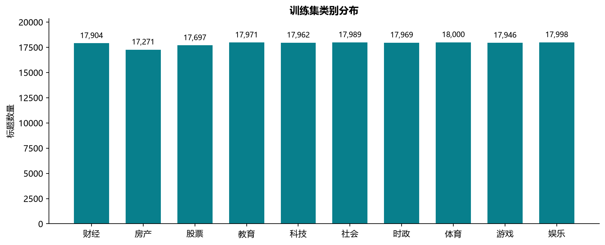
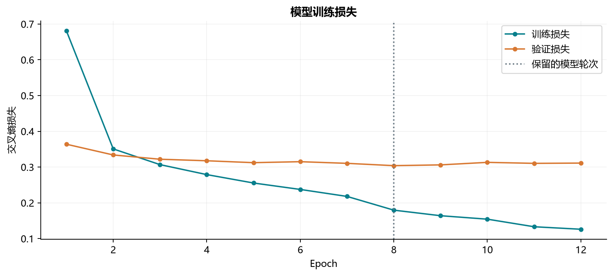
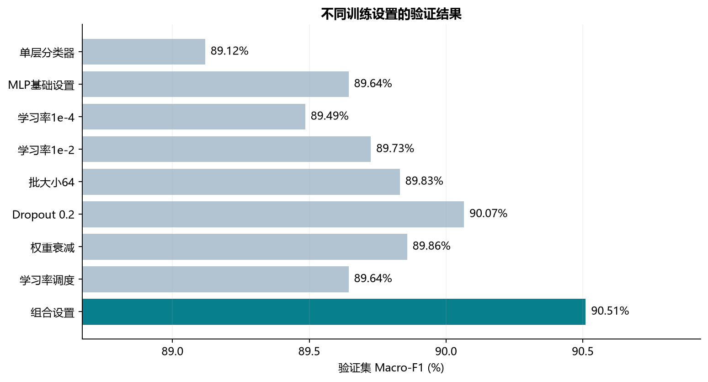
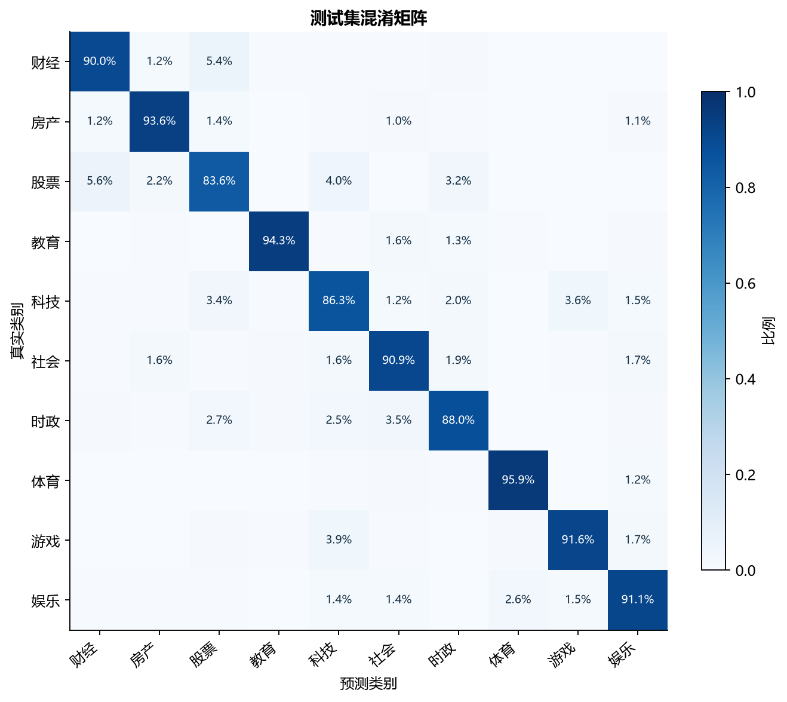
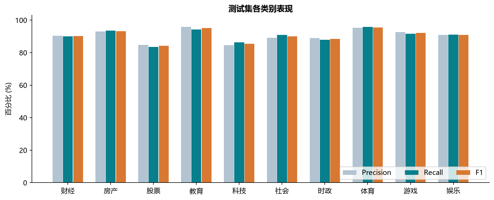

# 基于TF-IDF与多层感知机的十分类实验


## 一、数据集与划分


实验使用[公开的THUCNews新闻标题子集](https://github.com/649453932/Chinese-Text-Classification-Pytorch)，共20万条标题，分为财经、房产、股票、教育、科技、社会、时政、体育、游戏和娱乐10类。每条标题对应一个类别，任务是根据标题判断所属栏目。


沿用数据集原有的训练、验证和测试划分，去除重复标题及标签冲突记录。词表和IDF只由训练集计算，模型及参数通过验证集选择，测试集用于最终评估。


| 数据划分 | 原始数量 | 清洗后数量 |
| --- | --- | --- |
| 训练集 | 180,000 | 178,707 |
| 验证集 | 10,000 | 9,981 |
| 测试集 | 10,000 | 9,983 |





## 二、模型结构


先对标题做全半角、英文大小写和空白规范化，再以单字和相邻双字构建TF-IDF特征，将每条标题转换为5000维向量。分类模型采用两层隐藏层的多层感知机，隐藏层使用ReLU，输出10个类别分数。


```text
TF-IDF（5000维） → 全连接层（128） → 全连接层（64） → 输出层（10）
```


## 三、训练方法


训练采用交叉熵损失和Adam优化器，初始学习率为0.001，批大小为256，每轮打乱训练样本，最多训练18轮。隐藏层加入Dropout（0.2），权重衰减设为0.0001。


验证集Macro-F1进入平台期后将学习率减半；连续4轮未显著改善时提前停止。实验比较了学习率、批大小、Dropout、权重衰减及学习率调度等9组设置，按验证集Macro-F1保存最佳模型。


## 四、实验结果


组合设置取得了最高的验证集Macro-F1（90.51%）。模型实际训练12轮，保留第8轮的权重。下图展示训练过程、参数对照和测试集表现。














## 五、实验结论


本次实验采用TF-IDF和多层感知机完成中文新闻十分类。在9,983条测试标题中，正确分类9,037条，准确率为90.52%，Macro-F1为0.9052，平均交叉熵损失为0.2848。本次比较中，加入Dropout、权重衰减和学习率调度的组合设置表现最好，最终使用的是第8轮模型。
